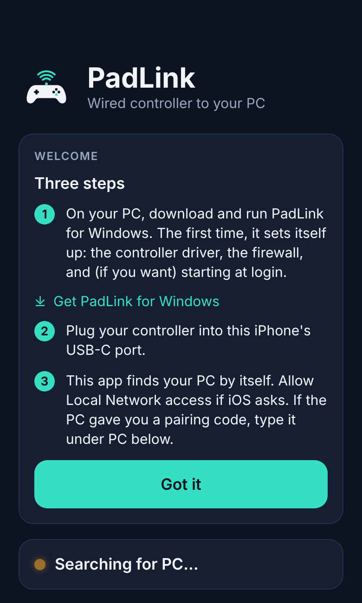
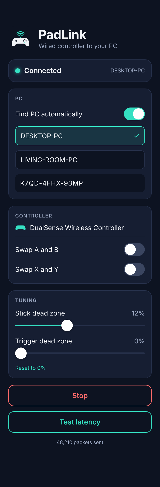
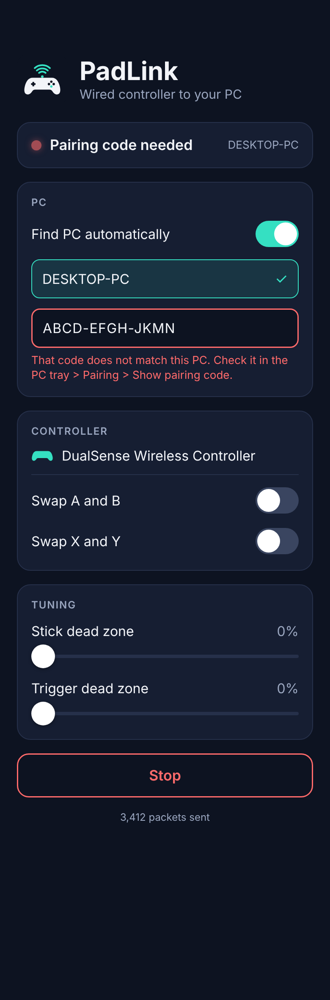
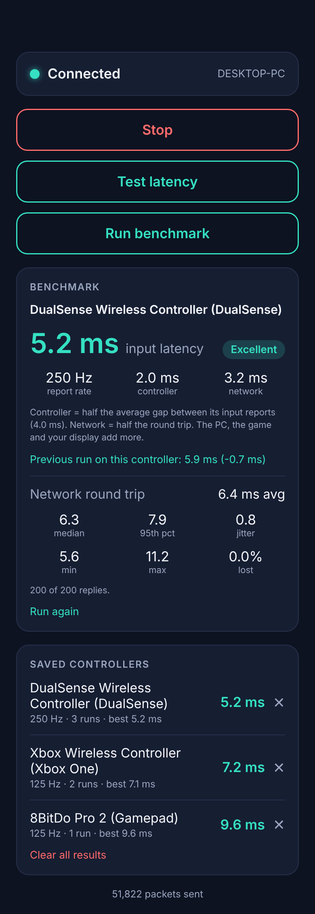
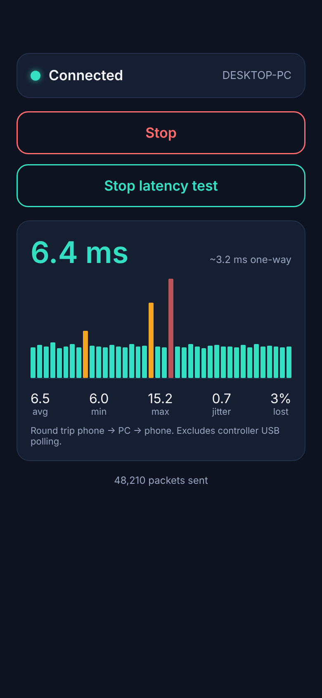
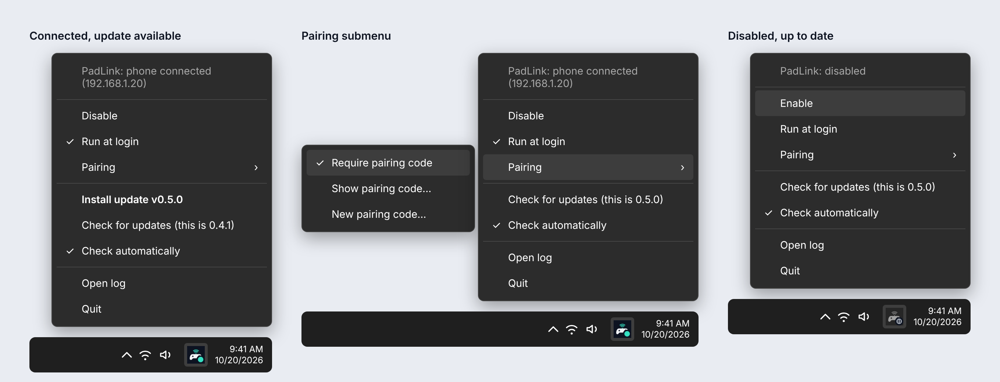
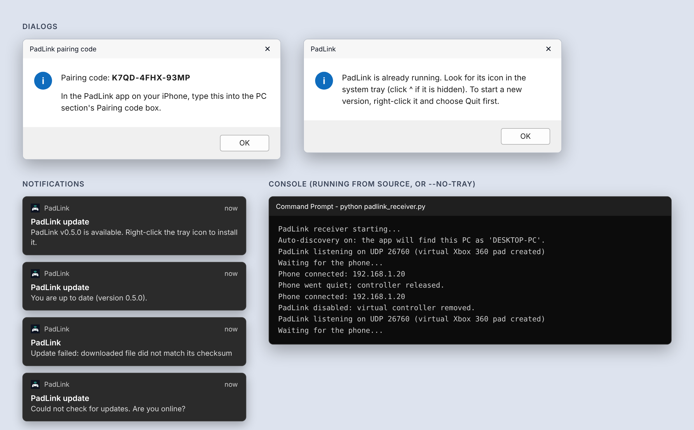

<p align="center">
  
</p>

<h1 align="center">PadLink</h1>

<p align="center"><b>Play PC games from the couch with a wired controller, without Bluetooth lag and without a long cable.</b></p>

PadLink turns your iPhone into a short-wire extension of your computer. Plug your controller into the phone with a short
cable, sit wherever you like, and the phone passes every button and stick movement to your PC over your own network.
The PC sees a normal Xbox 360 controller.

```
 your controller ──short USB-C cable──▶ iPhone (PadLink) ──Wi-Fi / Ethernet──▶ your PC (PadLink) ──▶ the game
```

## Why

| Option | The catch |
|---|---|
| Bluetooth controller | Convenient, but Bluetooth adds delay and random stutter. |
| Wired controller plugged into the PC | Lowest delay, but the cable has to reach the couch. |
| **PadLink** | **The controller stays wired (to the phone in your hands), so Bluetooth is out of the picture, and no long cable is needed.** |

The goal is simple: keep the speed of a wired controller, lose the long cable. Bluetooth is replaced by a short USB cable
to the phone, and the phone talks to the PC over Wi-Fi or Ethernet, which is far steadier. Typical numbers (estimates,
with a built-in benchmark so you can check your own setup):

- Bluetooth controller to PC: roughly 10-30 ms, with spikes.
- PadLink over good 5 GHz Wi-Fi: roughly 5-10 ms round trip (about half that each way), steady.
- PadLink over a wired link (USB-C Ethernet hub or a USB tether): roughly 2-4 ms round trip.

They depend on your controller, router and PC; see [Measure it](#measure-it).

### The couch setup
The PC runs the game on your TV or monitor. You sit on the couch with the phone and controller in your lap. Nothing else
is needed: no dongle, no long USB cable across the room.

### What PadLink is not
- **It does not stream video.** You still watch the game on the PC's screen. (Because the PC just sees an ordinary
  controller, it should also work with games you stream from that PC, but that is untested.)
- **It is not a real USB connection.** iOS cannot pretend to be a USB device, so the PC gets a virtual Xbox 360 pad.

## Quick start

**On the PC (Windows 11)**
1. Download `PadLinkReceiver.exe` from the [latest release](https://github.com/ajhockey88/PadLink/releases/latest) and double-click it.
2. Approve the one Windows prompt. It installs what it needs (controller driver, firewall rule) and asks two yes/no questions.
3. A PadLink icon appears in the system tray near the clock. That is it.

**On the iPhone (no Mac needed)**
1. Install `PadLink.ipa` from the same release with [Sideloadly](https://sideloadly.io/) (steps under [Install in detail](#install-in-detail)).
2. Plug your controller into the phone's USB-C port and open PadLink.
3. Tap **Allow** if iOS asks for Local Network access. The app finds your PC by itself and shows **Connected**.

Now play. Close the app whenever you like; the PC program keeps running and the phone reconnects next time you open it.

**You need:** an iPhone with USB-C (iPhone 15 or newer) on iOS 16+, a controller that works with it, a Windows 11 PC
(Windows 10 should work, untested), and both devices on the same network.

## Screenshots

> These are design renders of the interface (the mockups it was built from), with sample numbers, not photos of a running device. Real screenshots can replace them: save yours over the files in [`docs/images/`](docs/images/) with the same names.

**iPhone app**

<table>
  <tr>
    <td align="center" valign="top"><br><sub>First launch</sub></td>
    <td align="center" valign="top"><br><sub>Connected, with the tuning sliders</sub></td>
    <td align="center" valign="top"><br><sub>Pairing code needed</sub></td>
  </tr>
  <tr>
    <td align="center" valign="top"><br><sub>Benchmark result and saved controllers</sub></td>
    <td align="center" valign="top"><br><sub>Live latency test</sub></td>
    <td></td>
  </tr>
</table>

**PC tray menu** (status, Disable / Enable, Run at login, Pairing, updates, log, Quit)



**PC dialogs, notifications and console**



## What you get
- **Any controller iOS supports** (Xbox, DualSense, MFi, ...). Plug in several; their inputs are merged into one pad.
- **Vibration** from games is sent back to the controller (where iOS exposes its haptics).
- **Finds your PC by itself** and reconnects on its own after a dropped network, a replugged controller or a restarted PC.
- **Runs in the background** on the phone: switch apps or lock the screen and it keeps going.
- **Sets itself up** on the PC: one `.exe`, one approval prompt, a tray icon, optional start at login, self-updates.
- **Optional pairing code** so only your phone can send input to your PC.
- **Tuning:** swap A/B and X/Y, stick and trigger dead zones, and a send-rate setting.
- **Performance mode** on the PC (on by default) so Windows never slows PadLink down in the background.
- **Measuring:** live latency graph and a controller benchmark that saves a result per controller.
- **Private:** nothing leaves your network except the update check; no accounts, no analytics.

## Using PadLink

### Status
The line at the top of the app shows where things stand:

| Status | Meaning |
|---|---|
| Searching for PC | No PadLink program found yet. If you typed an IP address, the app falls back to it after a few seconds. |
| Connecting | Found a PC, waiting for it to answer. |
| Connected | The PC is answering. |
| Reconnecting | The PC stopped answering (network change, PC restarted); the app is rebuilding the connection. |
| Pairing code needed | The PC requires a pairing code and yours is missing or wrong. |

If more than one PC answers, tap the one you want; the app remembers. **Find PC automatically** can be turned off to type an IP address instead (`ipconfig` on the PC).

### Measure it
- **Test latency** shows a live graph of the network round trip (phone to PC and back) with average, min, max, jitter and lost pings. It only runs when you press it.
- **Run benchmark** rates a controller. For 10 seconds, move its stick in circles or mash buttons. The app measures how often the controller reports input and the network round trip (200 pings), and reports **input latency** = half the average gap between the controller's reports + half the network round trip. You also get median, 95th percentile, jitter, min, max, lost pings and a rating (Excellent under 10 ms, Good under 20, Fair under 40).
- Results are saved under the controller's name (up to 10 runs each), compared with its previous run, and listed fastest-first in **Saved controllers**, so you can try several controllers and compare them.
- The controller's report rate is measured from the timestamps iOS puts on each input report (the iOS 16 input-state queue, switched on only while a benchmark runs), which is more precise than counting app callbacks; if iOS does not provide them, the app falls back to callbacks and says so under the result.
- It is an estimate of the controller and network only; the PC, the game and your display add more. Two controllers of the same model share one entry, and so do wired and Bluetooth use of one controller, because iOS does not say which connection it is.

### Tuning
- **Swap A and B** / **Swap X and Y** flip those face buttons.
- **Stick dead zone** and **Trigger dead zone** (0-30%) ignore small movement near the center (stick drift) and rescale the rest, so full travel still reaches 100%.
- **Send rate** (250, 500 or 1000 Hz) is how often the controller's current state is re-sent even when nothing changed. A change is always sent the instant it happens, so this does not make normal input faster; a higher rate only recovers sooner from a dropped packet, and costs battery and Wi-Fi time. 250 Hz is right for most setups.

### Pairing (recommended)
Without it, anyone on your network could send controller input to your PC. Turn it on at the first-run question, or any time with tray > **Pairing** > **Require pairing code**. A message shows a 12-character code like `K7QD-4FHX-93MP`. Type it into the **Pairing code** box in the app (PC card) once; it is remembered. From then on the PC ignores anything not signed with that code, and the app tells you if the code is missing or wrong. **New pairing code...** replaces it.

Pairing proves a packet came from your phone; it does not encrypt the traffic or stop someone who can capture your network from replaying it. Keep the PC on a network you trust.

### The PC tray icon
The badge on the icon shows the state: green = phone connected, amber = waiting for the phone (or setting up / updating), gray = disabled, red = error. Hover for the exact status. Right-click for:
- **Disable / Enable:** Disable removes the virtual controller from Windows and stops answering the phone.
- **Run at login:** starts it hidden every time you sign in (no administrator rights needed).
- **Performance mode:** on by default. Gives PadLink high priority, stops Windows putting it in efficiency mode (which can add delay to a tray program), and asks for a 1 ms system timer. Uncheck it if you ever want PadLink to behave like an ordinary background program.
- **Pairing:** require, show or replace the code.
- **Install update / Check for updates / Check automatically:** PadLink checks GitHub about once a day, downloads a new version when you choose, verifies its SHA-256 checksum and restarts on it. (Versions before 0.4.1 have no updater: replace them by hand once. The iPhone app is not covered; reinstall its `.ipa`.)
- **Open log** and **Quit.**

## Get the most from your connection
| Option | Setup | Typical round trip |
|---|---|---|
| Wi-Fi (5/6 GHz, near the router) | Same network as the PC | about 5-10 ms |
| USB-C hub with Ethernet | Hub carries controller, Ethernet and power | about 2-4 ms |
| USB cable + Personal Hotspot | Plug the iPhone into the PC | about 2-4 ms |

For the couch, good Wi-Fi is usually enough. To squeeze out more: sit within range of the router (or put the PC on Ethernet, which helps), use the 5 or 6 GHz band, keep the phone out of Low Power Mode, and turn off "client/AP isolation" on the router. Use **Run benchmark** before and after a change to see what it did.

## Install in detail

<details>
<summary><b>PC (Windows 11)</b></summary>

1. Download `PadLinkReceiver.exe` and double-click it. That is the only step; it sets itself up.
2. **On first run it does this for you** (one Windows approval prompt, because it changes system settings):
   - installs the virtual-controller driver (ViGEmBus), which is bundled inside the exe;
   - adds a Windows Firewall rule named **PadLink** that allows UDP 26760 (controller data) and 5353 (finding the PC), from devices on your own network only, on any network type (Private, Public, Domain);
   - then asks two yes/no questions: start PadLink when you sign in to Windows (recommended), and require a pairing code (recommended).
3. A PadLink icon appears in the system tray (click `^` if hidden) and you hear a controller chime. If the driver was just installed and it still reports an error, restart Windows once.
4. If you said no to starting at login, tick **Run at login** in the tray menu any time. This copies the exe to `%LOCALAPPDATA%\PadLink` so you can delete the download.

**Port forwarding is not needed, and you should not set it up.** The phone and PC talk over your own network, so nothing has to be opened on your router. Forwarding the port would expose your controller input to the internet. PadLink deliberately does not do this (no UPnP, no router changes).

Windows SmartScreen may warn because the exe is not code-signed: choose **More info** then **Run anyway**. Some antivirus programs flag unsigned PyInstaller programs; the source is in this repository.

**From source (advanced):** unzip `PadLinkReceiver.zip`, install Python 3.12+ and run `python padlink_receiver.py` (`--no-tray` for console only). On first run it installs any missing Python packages itself and does the same driver and firewall setup as the exe. See [`Windows/README.md`](Windows/README.md).
</details>

<details>
<summary><b>iPhone (no Mac needed)</b></summary>

1. Install [Sideloadly](https://sideloadly.io/) on the PC, plus iTunes and iCloud from Apple's site (not the Microsoft Store versions).
2. Plug in the iPhone, tap Trust, drag `PadLink.ipa` into Sideloadly, enter your Apple ID and click Start.
3. On the iPhone: Settings > General > VPN & Device Management > trust your Apple ID. Enable Developer Mode if asked.
4. A free Apple ID's app expires after 7 days; run Sideloadly again to renew. A paid developer account lasts a year.
5. Open PadLink. A welcome card lists the steps; it goes away when you tap **Got it** or once the app connects to a PC. iOS asks for **Local Network** access the first time; tap Allow (apps cannot do that for you).
</details>

## Troubleshooting

<details>
<summary><b>Common problems</b></summary>

- **The app says "Searching for PC":** make sure the PadLink icon is in the PC's tray, both devices are on the same network, and you allowed Local Network access for the app (iPhone Settings > PadLink). Finding the PC uses UDP 5353, which the first-run firewall rule opens. As a fallback, turn off **Find PC automatically** and type the PC's IP address.
- **"Pairing code needed":** the PC requires a code. On the PC: tray > Pairing > Show pairing code, then type it into the app's PC card.
- **Latency test shows "No reply":** wrong address, PadLink not running, wrong pairing code, or the firewall rule was not added (you declined the prompt). Quit PadLink from the tray and run it again to retry, or run once as administrator: `netsh advfirewall firewall add rule name=PadLink dir=in action=allow protocol=UDP localport=26760,5353 remoteip=LocalSubnet profile=any`.
- **Opening a second copy shows "PadLink is already running":** use the first copy's tray icon to Quit it, then start the new one (or use the tray's update).
- **"Driver missing" or a startup error mentioning ViGEm:** the exe installs the driver on first run; if you declined the prompt, right-click the tray icon, choose **Enable** to retry, then restart Windows. Manual installer: [ViGEmBus releases](https://github.com/nefarius/ViGEmBus/releases).
- **No controller in `joy.cpl`:** the controller is created when PadLink starts or is re-enabled; look for the chime.
- **No vibration:** it needs a controller whose haptics iOS supports (for example DualSense or Xbox) and a game that sends rumble.
- **Wi-Fi is hit-or-miss:** see [Get the most from your connection](#get-the-most-from-your-connection).
- **Anything else:** tray > **Open log**.
</details>

## Questions

<details>
<summary><b>Do I need a Mac?</b></summary>

No. The iPhone app is built in the cloud and installed from Windows with Sideloadly.
</details>

<details>
<summary><b>Why not just use Bluetooth, or a long wire?</b></summary>

Bluetooth is convenient but adds delay and jitter. A long wire to the PC is fast but awkward on a couch. PadLink gives you a wired controller (to the phone) and a steady network link (phone to PC), so you get the benefit of both.
</details>

<details>
<summary><b>Can PadLink overclock my controller?</b></summary>

Not the controller itself, and no iPhone app can. How often a controller reports its state (its polling rate, for example 125 Hz or 1000 Hz) is set by the controller's own firmware, and iOS simply follows it. PadLink does everything on its own side that it can: it sends every change immediately, offers the **Send rate** setting, and **Performance mode** on the PC keeps Windows from throttling it.

To raise the controller's real rate, look at the controller: some have a polling-rate or "high speed" setting in their own app or firmware, or a mode switch (often wired mode only), and a wired USB connection is always faster than Bluetooth. Then run **Run benchmark** before and after and compare **report rate**, which is the number that changes if it worked. It matters: the controller adds about half the gap between its reports on average, so 125 Hz (8 ms gap) adds about 4 ms and 1000 Hz (1 ms gap) about 0.5 ms. The well-known DualSense "overclock" guides use a Windows filter driver (HIDUSBF) that makes Windows read a wired controller more often. That changes how the PC polls a device plugged into the PC, so it has no effect on a controller plugged into the phone. Claims of 8000 Hz are disputed; the reports I could find settle at 1000 Hz, and a rate shown in a tool is not proof the controller itself reports that fast. Only the benchmark's **report rate** shows what the phone really receives.
</details>

<details>
<summary><b>Is it safe?</b></summary>

Controller data goes only from your phone to your PC over your own network. The PC program contacts GitHub (`api.github.com`) to check for releases (you can turn that off in the tray) and verifies a SHA-256 checksum before installing an update. The firewall rule only allows devices on your own subnet, and PadLink never touches your router. The pairing code lives in plain text in `settings.json` next to the exe. There are no accounts and no analytics.
</details>

## Limits
- One virtual Xbox 360 pad. Several physical controllers are merged into it, not split into players.
- Gyro, touchpad and adaptive triggers are not forwarded.
- iOS can end a backgrounded app under memory pressure, and the app keeps itself alive with a silent audio session, which costs a little battery.
- Pairing authenticates but does not encrypt.
- The exe is not code-signed, and the iPhone app must be re-signed every 7 days with a free Apple ID.
- Built and checked with automated tests and cloud builds; not tested on every controller, network or Windows version. Reports and fixes are welcome.

## For developers

<details>
<summary><b>Project layout, tests and releases</b></summary>

| Path | What it is |
|---|---|
| `iOS/` | The iPhone app (SwiftUI) and `project.yml` for XcodeGen |
| `Windows/padlink_receiver.py` | The PC program (also packed into the exe), `requirements.txt`, `install_startup.ps1`, `stamp_version.py` |
| `tests/` | Automated tests for the PC program (packet format, pairing, updater, first-run setup) |
| `design/` | App icon artwork (`icon.svg` is the master; colors navy `#0D1321`, off-white `#F2F4F8`, mint `#35E0C2`) |
| `docs/` | The interface mockups (`docs/mockups/`) and the images rendered from them for this README (`docs/images/`); regenerate with `python docs/render_mockups.py` (needs Node.js, Pillow and Chromium) |
| `PROTOCOL.md` | The wire format |
| `.github/workflows/release.yml` | Builds and publishes releases |

Run the tests with `python -m unittest discover -s tests -v` (no Windows or driver needed).

Releases are built by GitHub Actions ("Build and release", started manually from the Actions tab). The `RELEASE_TAG` value at the top of `release.yml` is the version published. The workflow runs the tests first, then builds in parallel: the iPhone app on a macOS runner (generated with [XcodeGen](https://github.com/yonaskolb/XcodeGen), packaged as an unsigned IPA for sideloading) and the PC exe on a Windows runner (PyInstaller; it fetches the `vgamepad` source directly and verifies its checksum, because installing that package normally launches a driver installer). Then it creates the GitHub release with the `.ipa`, `.exe` and `.zip`, and stamps the version into the exe so its updater knows what it is running.
</details>

## License
PadLink is released under the [MIT License](LICENSE). The Windows exe bundles third-party components under their own licenses; see [THIRD_PARTY_NOTICES.md](THIRD_PARTY_NOTICES.md).
